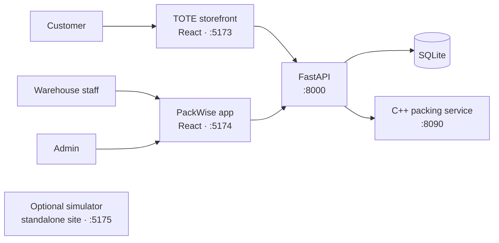

# TOTE + PackWise

**A storefront and warehouse packing system.** TOTE takes the order; PackWise finds a safe carton and gives warehouse staff a clear packing plan.

<p align="center">
  <a href="#quick-start">Quick start</a> ·
  <a href="#architecture">Architecture</a> ·
  <a href="#apps">Apps</a> ·
  <a href="#api-and-health">API & health</a>
</p>

## Architecture



The two web apps share one API. The API stores orders and inventory, then calls the C++ service for carton layouts. The simulator site is an optional standalone demo.

## Quick start

**Windows:** run `setup.bat` once, then `start-all.bat`. The scripts open the services in separate windows.

| App | Local address |
|---|---|
| TOTE storefront | [localhost:5173](http://localhost:5173) |
| PackWise warehouse app | [localhost:5174](http://localhost:5174) |
| Admin console | [localhost:5174/admin/login](http://localhost:5174/admin/login) |
| API health | [localhost:8000/api/health](http://localhost:8000/api/health) |
| API docs | [localhost:8000/docs](http://localhost:8000/docs) |
| C++ engine health | [localhost:8090/health](http://localhost:8090/health) |
| Optional simulator | [localhost:5175](http://localhost:5175) |

<details>
<summary>Start one service manually</summary>

Run each command from the project root in its own terminal.

```powershell
# C++ carton engine
cpp-packer-service\build\packer_service.exe 8090

# API
cd backend
.\.venv\Scripts\python.exe -m uvicorn app.main:app --reload --port 8000

# TOTE storefront
cd tote-frontend
npm run dev

# PackWise warehouse app
cd packwise-frontend
npm run dev
```

If the C++ build is missing, use `cpp-packer-service\prebuilt\packer_service.exe 8090` or build it with `cpp-packer-service\build.bat` (MSYS2 MinGW-w64).
</details>

## Apps

| App | Main purpose |
|---|---|
| **TOTE** | Product browsing, cart, simulated checkout, and order tracking. |
| **PackWise** | Order queue, carton recommendations, 3D placement plan, and packing workflow. |
| **Admin console** | Manage products, cartons, stock, materials, settings, orders, and reports. |
| **Simulator** | Explore the packing algorithm separately from the warehouse workflow. |

## How carton selection works

The backend prepares item dimensions and protection requirements, asks the C++ engine for a layout, and chooses the smallest available carton that safely fits. The default `optimizer2` algorithm packs in one layer, keeps items upright, and allows 90° rotation on the floor. Select `original` or `optimizer` with `PACKING_ALGORITHM` in `backend/.env`.

Carton sizes and sustainability figures are demo estimates until physical dimensions, material use, and routes are verified. Payments are simulated; no money is charged.

<details>
<summary>Configuration and safeguards</summary>

Backend settings live in `backend/.env`; the browser apps use `VITE_API_URL` (default: `http://localhost:8000`). Keep secrets in local environment files and out of commits.

Useful settings include:

| Setting | Purpose |
|---|---|
| `PACKING_ALGORITHM` | `optimizer2` (default), `optimizer`, or `original`. |
| `PACKER_URL` | C++ engine address; defaults to `http://127.0.0.1:8090`. |
| `PACKWISE_WORKER_CODE` | Shared warehouse sign-in code. |
| `ADMIN_ACCESS_CODE` | Admin console sign-in code. |

SQLite data is stored in `backend/data/`. Admin access uses a shared demo code; it is not production identity management.
</details>

## API and health

Open the interactive [Swagger API docs](http://localhost:8000/docs) while the API is running. Authenticate with a token from `/api/auth/login`, `/api/auth/worker`, or `/api/auth/admin` to try protected endpoints.

<<<<<<< HEAD
Frontends read `VITE_API_URL` from their own `.env` (default `http://localhost:8000`).

## Deploying the full app

The two Vite frontends and FastAPI API can be deployed as separate Vercel projects from this repository. The C++ packing service runs as a container on a host that supports a long-running HTTP service. The API needs managed PostgreSQL in production; the local SQLite file is not durable serverless storage.

### Vercel projects

Create three Vercel projects connected to this GitHub repository:

| Project | Root Directory | Build settings | Required environment variables |
| --- | --- | --- | --- |
| TOTE storefront | `tote-frontend` | Vite; `npm run build`; output `dist` | `VITE_API_URL` = deployed API URL |
| PackWise warehouse | `packwise-frontend` | Vite; `npm run build`; output `dist` | `VITE_API_URL` = deployed API URL |
| FastAPI | `backend` | FastAPI/Python auto-detect | `DATABASE_URL`, `PACKER_URL`, `CORS_ORIGINS`, `PACKWISE_WORKER_CODE`, `ADMIN_ACCESS_CODE` |

Set `CORS_ORIGINS` on the API project to the two production frontend origins, comma-separated. Set `DATABASE_URL` to the provider's pooled PostgreSQL URL. Vercel runs FastAPI as request-based functions; do not point `PACKER_URL` at localhost. Store secrets in the Vercel dashboard, not in frontend variables. Only `VITE_API_URL` belongs in a frontend project.

### C++ packing service

For example, on Render create a Web Service from this repository, set the root directory to `cpp-packer-service`, choose Docker, and set the health check path to `/health`. The included Dockerfile binds to `0.0.0.0` and uses the host-provided `PORT`, as Render requires. Use the resulting public HTTPS URL as `PACKER_URL` in the FastAPI project. Another container host that supports a continuously running HTTP service can use the same Dockerfile.

### Database and first deployment

The API creates the current schema and seeds the sample catalogue when it starts. A new PostgreSQL database starts with the sample catalogue; it does not import the local SQLite database or its customer/order records. Add the required API secrets and production CORS origins, deploy the packing container, then deploy the API with its `DATABASE_URL` and `PACKER_URL`. Finally deploy both frontends with the API's public URL in `VITE_API_URL` and redeploy them whenever that build-time variable changes.

## 11. Project structure

```
tote-packwise/
├── backend/                 FastAPI + SQLite
│   ├── app/
│   │   ├── main.py          app, CORS, startup migration + seeding
│   │   ├── migrate.py       safe schema upgrades for older databases (cartons cm → mm, checkout key)
│   │   ├── models.py        tables
│   │   ├── schemas.py       request validation
│   │   ├── security.py      PBKDF2 passwords, session tokens, role checks
│   │   ├── seed.py          idempotent seed data (30 products, 8 standard cartons, materials)
│   │   ├── routers/         auth, catalog, shop, orders, packwise, admin, health, simulator, sim_public
│   │   └── services/        packer_client, feasibility, packing, inventory, orders, reports, audit
│   └── tests/               pytest suite
├── cpp-packer-service/      C++ HTTP microservice (original algorithm + adapter)
├── tote-frontend/           React storefront
├── packwise-frontend/       React warehouse app + admin console (src/pages/admin, components/AdminShell.jsx)
├── simulator-site/          Packing Simulator website (plain HTML, algorithm ported to JS)
├── setup.bat, start-all.bat
└── README.md
=======
```text
GET  /api/health             API and database status
GET  /api/health/packer      C++ engine status
POST /api/orders/checkout    Place a simulated order
GET  /api/orders/{code}      Track an order
GET  /api/packwise/orders    Warehouse order queue
>>>>>>> 4a77ee3b6403b527c02a51cbdcdee7e7ba43f482
```

## Project map

```text
backend/             FastAPI API, SQLite models, packing and order services
cpp-packer-service/  C++ layout engine and HTTP adapter
tote-frontend/       Customer storefront (React + Vite)
packwise-frontend/   Warehouse and admin app (React + Vite)
simulator-site/      Optional standalone simulator
setup.bat            One-time Windows setup
start-all.bat        Launch the local services
```

## Troubleshooting

<details>
<summary>Something is not loading?</summary>

- **TOTE cannot reach the server:** check [API health](http://localhost:8000/api/health), then confirm `VITE_API_URL` points to port `8000`.
- **Packing engine offline:** start the C++ service and check [engine health](http://localhost:8090/health).
- **Port already in use:** close the existing service window before running `start-all.bat` again.
- **Python or C++ setup fails:** see `backend/requirements.txt` and `cpp-packer-service/README.md` for component-specific setup.
- **Order or stock looks unexpected:** local data persists in `backend/data/tote_packwise.db`; restarting does not reset it.

</details>

<sub>Built as a local demo. Verify carton dimensions and operational assumptions before using packing or impact estimates in real shipments.</sub>
